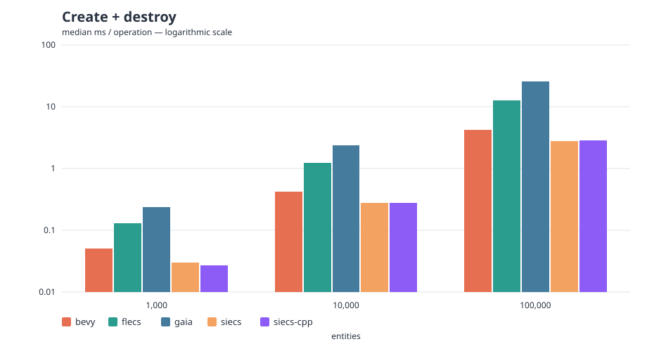
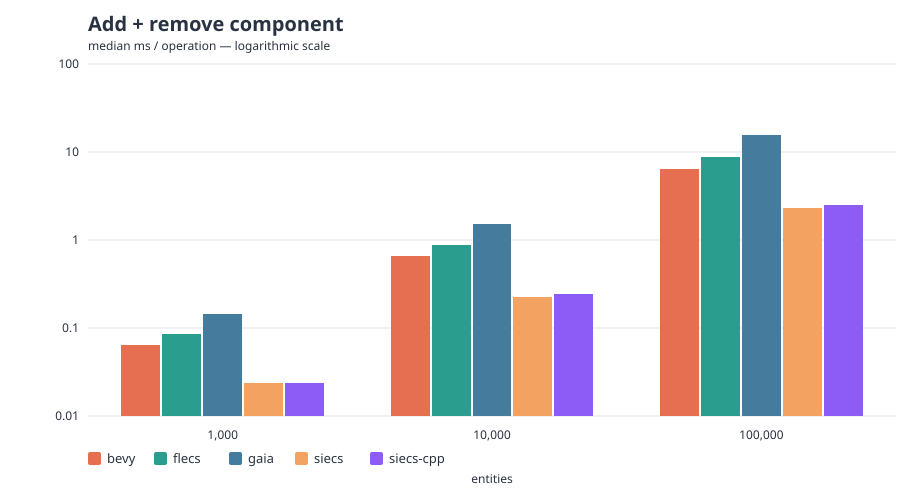
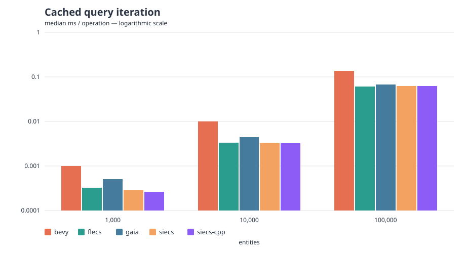

<!-- Generated by ./bench from README.template.md. Do not edit README.md directly. -->

# Archetype ECS Benchmark

An experimental, language-agnostic harness for comparing archetype ECS
implementations through a shared set of workloads.

Each adapter uses the implementation's native language and API. The common
runner builds and executes the adapters, validates their measurements,
aggregates the samples, generates SVG charts, and updates this README.

## Run everything

Requirements: Git, Python 3.11+, CMake 3.20+, Ninja, and a C/C++23
compiler. Rust 1.95+ is required by the Bevy adapter. Siecs is taken from
the local checkout at `../siecs` only when clean and at the pinned commit;
otherwise it is cloned at that commit into the build cache. External
dependencies are pinned and downloaded on the first run.

```console
./bench
```

That single command builds every enabled adapter in release mode, runs the
full suite, writes raw and aggregated results, generates SVG graphs, and
updates this README. For a fast local check:

```console
./bench --quick
```

Useful variants:

```console
./bench --quick --system flecs
./bench --workload iterate --entities 100000 --samples 20
./bench build
./bench list
./bench validate
make test
```

Historical runs go to `results/runs/<timestamp>/` and are ignored by Git.
The publishable snapshot lives in `results/latest/`.

## What is measured

The suite currently defines three single-threaded operations:

- **Create + destroy**: create `N` entities containing `Position`, then destroy
  them, using individual native operations.
- **Add + remove**: add `Velocity` to `N` entities already containing
  `Position`, then remove it. This measures two archetype migrations.
- **Cached query iteration**: update every `Position` through a cached
  `Position + Velocity` query.

World construction, initial population, query construction, warmup, checksum,
process startup, and result serialization are outside the timed region.
Component values and operation order are identical between adapters. See
[the complete protocol](docs/PROTOCOL.md) before interpreting or contributing
results.

<!-- BENCH_RESULTS:BEGIN -->

## Latest results

Generated `2026-10-20T18:20:50.605656+00:00` on **Intel(R) Core(TM) Ultra 9 185H** (22 logical CPUs, `Linux-7.2.9-2-cachyos-bore-lto-x86_64-with-glibc2.44`).

Profile: **full suite** with 10 samples and 2 warmup iteration(s).

> **Experimental results.** These benchmarks exercise only a small, common subset of each ECS API. They do not cover every usage pattern or configuration, and the adapters may not always express each ECS at its best. Results can therefore be incomplete or misinterpreted; use them as exploratory measurements, not as a definitive ranking.

Values are median milliseconds per operation; lower is better. Setup is excluded from the timed region.

| Workload | Entities | bevy 0.20.0 | flecs 4.1.6 | gaia 1.0.0 | siecs 3ec5021 |
|---|---:|---:|---:|---:|---:|
| Create + destroy | 1,000 | 0.111 | 0.229 | 0.429 | 0.081 |
| Create + destroy | 10,000 | 0.806 | 2.273 | 4.441 | 0.681 |
| Create + destroy | 100,000 | 7.748 | 12.843 | 46.239 | 4.480 |
| Add + remove component | 1,000 | 0.060 | 0.158 | 0.215 | 0.087 |
| Add + remove component | 10,000 | 0.759 | 0.905 | 1.560 | 0.486 |
| Add + remove component | 100,000 | 6.509 | 9.117 | 18.243 | 3.899 |
| Cached query iteration | 1,000 | 0.001 | 0.001 | 0.000 | 0.001 |
| Cached query iteration | 10,000 | 0.023 | 0.003 | 0.009 | 0.005 |
| Cached query iteration | 100,000 | 0.235 | 0.118 | 0.071 | 0.109 |







Raw samples and full statistics: [raw.jsonl](results/latest/raw.jsonl), [summary.csv](results/latest/summary.csv), [run.json](results/latest/run.json).

<!-- BENCH_RESULTS:END -->

## Add another ECS

The runner does not contain a list of ECS implementations. It discovers
`adapters/*/project.toml`, so a new language or build system does not require
changes to the infrastructure.

```console
./bench scaffold myecs \
  --name "My ECS" \
  --language C \
  --version 1.0.0 \
  --url https://example.com/myecs
```

Implement the small executable contract, enable its manifest, then run:

```console
./bench validate
./bench --quick --system myecs
```

The step-by-step guide is in [Adding an ECS](docs/ADDING_AN_ECS.md).

## Adapter notes

Adapter-specific build choices matter when interpreting the results:

- Flecs uses a custom core-only build. Feature addons are disabled; only
  `FLECS_OS_API_IMPL`, its platform and allocator backend, remains. The
  executable verifies this and release mode at startup.
- Siecs uses its official `distr/siecs.c/.h` amalgamation in release mode.
  Reflection metadata is now part of the core; the former no-addons
  distribution is no longer available. A clean `../siecs` checkout at the
  pinned commit is preferred, with a pinned clone used as fallback.

## Repository layout

```text
adapters/<id>/project.toml  build/run manifest plus native benchmark code
suite.toml                  workloads, entity counts, samples, warmup
tools/bench.py              discovery, execution, validation, reports
results/runs/               local timestamped history (ignored)
results/latest/             publishable CSV, NDJSON, metadata, SVG
docs/                       protocol and contributor guide
```

Benchmark numbers only describe the pinned versions, flags, machine, and
workloads recorded with them. They are not a universal ranking of each
library.
